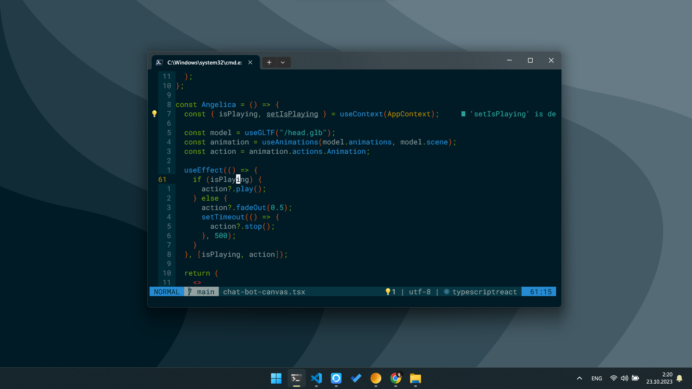

> view:



> setup:

```
npm install -g typescript typescript-language-server
npm install -g prettier@latest
npm install -g @typescript-eslint/parser @typescript-eslint/eslint-plugin eslint
```

> hotkeys (general):

```
control ` - toggle terminal

leader e - toggle neo-tree and editor with focus
leader n - toggle neo-tree

leader f - files
leader / - live grep
leader b - files buffer

leader d d - workspace diagnostics
leader d n - get to next diagnostics
leader d p - get to previous diagnostics


f d - delete selected without copy to clipboard
shift k - delete line without copy to clipboard
g h - get help
leader h - start of line
leader l - end of line
```
